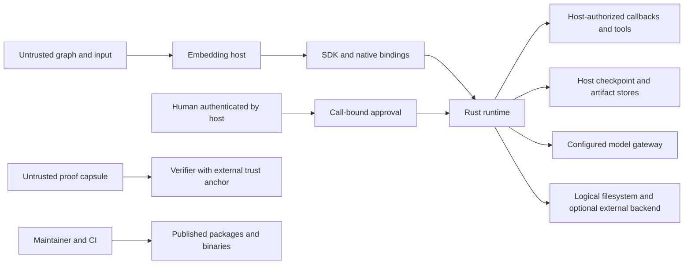

# Ailu Core — Threat model

Public, sanitized architecture baseline · 2026-10-29.

This document describes intended security properties, attacker capabilities and
integration responsibilities. It is not an audit result, a claim that controls
are complete, or a statement that a particular release is free of vulnerabilities.
The architecture baseline was reviewed at source revision
`d16216e11a1e72db401a6e2ee34c0894bc88413a`; consumers must reconcile it with the
exact package and native binary versions they deploy. No new scan or test was
run to publish this document. Unpublished findings and deployment details are
intentionally excluded; report vulnerabilities privately as described in
[SECURITY.md](SECURITY.md).

## 1. System and data flow

Ailu Core is an embeddable graph execution framework, not a hosted identity or
tenant service. The TypeScript SDK invokes native bindings and the Rust runtime.
Python/C bindings are separate entry points. The runtime coordinates nodes,
state, conditions, human gates, callbacks, checkpoints and replay. The host
application supplies identities, durable stores and permitted external effects.

Source landmarks: `packages/graph-sdk/src/compiled-graph.ts`,
`packages/graph-sdk/src/rust-engine.ts`,
`crates/runtime-bridge/src/catalog_approvals.rs`, `crates/runtime-bridge/src/lib.rs`,
`crates/fs-backend/`, `crates/sandbox/`, `packages/verify/`, `plugin/mcp/server.mts`.
These identify components, not locations of unpublished defects.

## 2. Assets and trust boundaries

Protect execution state and reserved channels, checkpoints, journals and artifacts;
run/namespace identity; approval records and grants; provider credentials;
confidential inputs and outputs; compute and provider budgets; package provenance;
and the integrity and origin represented by proof verification.

| Boundary | Required responsibility |
|---|---|
| Caller → host | Authenticate identities and authorize the tenant, run and resource before execution or retrieval. |
| Graph/model → runtime | Treat graph data and tool arguments as untrusted; keep reserved metadata separate from caller input. |
| Runtime → callback | Expose only capabilities deliberately granted by the host; recheck sensitive effects at their boundary. |
| Human → approval resolver | Authenticate the person independently of model-generated strings; bind the decision to the exact operation. |
| Runtime → durable store | Preserve integrity and isolation of state and artifacts; authenticate restored state and fence stale writers. |
| Runtime → provider/backend | Authorize the destination and credentials, limit resources and account for data leaving the process. |
| Capsule → verifier | Obtain a trusted issuer key independently of the supplied capsule; distinguish integrity from trusted origin. |
| CI → distribution | Publish only authorized revisions and matching native artifacts using protected credentials. |

## 3. Attacker capabilities and assumptions

- A graph author controls only graph definitions and input channels exposed by the
  host. This does not grant release, environment, database or operator privileges.
- A malicious model or retrieved document can influence text and tool arguments.
  It must not create authorization, a human identity or an approval by assertion.
- A configured provider or backend can return arbitrary, delayed or oversized data.
  Its configuration does not make every response trustworthy.
- A local MCP client can invoke its exposed tools within host permissions. Its
  confirmations, filesystem isolation and authentication are separate controls.
- A capsule supplier controls all capsule bytes, including any embedded key.
- Release maintainers and operators are privileged actors; their capabilities
  must not be silently attributed to normal graph callers.

The embedding host owns user authentication, tenant selection, callback rights,
durable storage and deployment isolation. Core remains responsible for its own
input validation, metadata separation and execution contracts. A native library
or a logical policy guard is not an operating-system sandbox. Multi-tenant impact
requires a concrete shared host/store and a demonstrated crossed authority.

## 4. Security objectives and scenarios to evaluate

These are review objectives, not disclosures or assertions of existing defects.

| Scenario | Required invariant / validation objective |
|---|---|
| Untrusted graph requests a privileged effect | Named registered handlers only; no evaluation or dynamic import of user strings; effect denied without capability. |
| Caller supplies internal metadata | Reserved channels and authorization metadata cannot be promoted from caller data into trusted state. |
| Execution suspends and resumes, including nested graphs | Approval is bound to the expected tenant/run/node and exact call; all relevant descendants preserve the same invariant. |
| Agent supplies an alleged approver identity | Independent host authentication is required; a string, hash or model response is not human consent. |
| Retry or crash follows an external effect | Host and runtime contracts distinguish checkpoints from external idempotency; reconcile durable receipts before repetition. |
| Another run accesses stored state or an artifact | Unambiguous composite identities and storage authorization preserve run/namespace isolation. |
| A provider or tool expands resource use | Bound concurrency, collection size, streaming buffers, parsing, recursion, retention and downstream budgets before allocation. |
| A custom destination receives credentials or content | Use explicitly authorized credential sources and destinations; secret-name allowlists do not replace network policy. |
| Logical filesystem or sandbox is enabled | Validate paths and capabilities; qualify the actual backend, input/output ownership, redaction and isolation before activation. |
| A proof is imported or replayed | Verify against an external trust anchor; integrity, issuer identity, completeness and reproduction are distinct claims. |
| A package is released | Bind authorized source revisions to build outputs and native binaries; protect publishing credentials and approvals. |

## 5. Configuration and deployment questions

- Which bindings, runtime and package versions are actually consumed?
- Who authenticates the approver and protects approval/checkpoint persistence?
- Are stores shared across runs or tenants? Where is access enforced?
- Which provider credentials, custom endpoints and filesystem backends are enabled?
- Which data can leave the process, to which destinations and under which policy?
- What limits protect a shared host from one run's resource demand?
- Is a concrete sandbox backend enabled and independently qualified?
- Which issuer keys are trusted by each verifier, and how are they distributed?

Do not infer deployment guarantees from defaults or documentation alone. Review
these assumptions after changes to bindings, approvals, providers, persistence,
filesystem, sandbox or distribution. Preserve the existing reporting and support
policy in SECURITY.md; this model does not create a new support commitment.

## 6. Severity calibration

Assess severity from reachable attacker capabilities, crossed authority and actual
impact. Critical requires a demonstrated major compromise with credible entry
conditions. High concerns unauthorized sensitive execution or trusted-origin
claims with material impact. Medium covers narrower privilege/resource abuse;
Low covers confined impact without a broader demonstrated boundary crossing.
Do not dismiss local inputs by default or claim cross-tenant impact without a
shared deployment and evidence. Confidence, severity and production exposure
are separate dimensions. No finding is accepted, closed or remediated by this
model, and this document does not authorize scans, releases or external effects.
