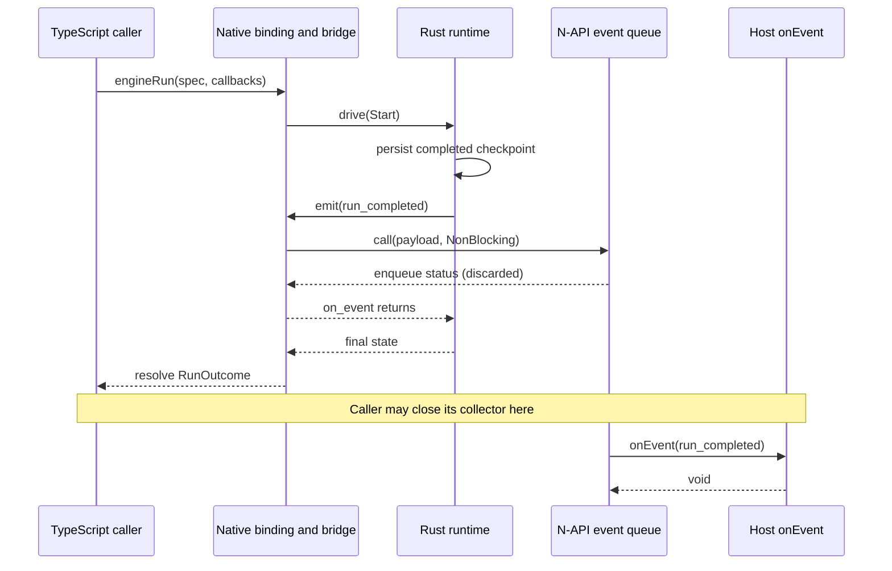
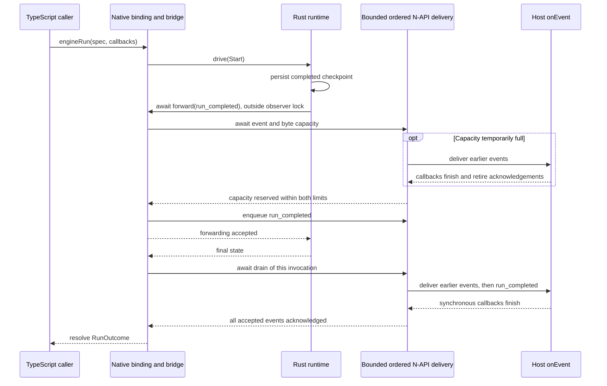

# ADR 0059 — Deliver closing run events before returning

- Status: **Proposed**, awaiting coordinator and owner review; no implementation authorized.
- Date: 2026-11-14
- Decider: Mathieu (owner)
- Product reference: ADR-281, decision 239
- Relates to: [0044](./0044-cooperative-run-cancellation.md) (transition events),
  [0049](./0049-the-host-keeps-each-checkpoint.md) (checkpoint before closing run event),
  [0050](./0050-each-fan-out-spawn-reports-its-lifecycle.md) (concurrent spawn events).

## Context and code evidence

The native TypeScript call can return its final state before the host receives its closing
event. A caller that closes its event collector immediately after `await run()` can miss that
event. The runtime contract requires an event for each lifecycle transition, in emission order,
and the closing event delivered before the invocation returns.

Evidence at `f4786af7baa6a9fc71e9e6ca4f9554186b516fba`:

- `crates/graph-runtime/src/runtime.rs:1480–1490,1152–1158`: completion is checkpointed, then
  `run_completed` is emitted before the state returns. Failure, cancellation and suspension also
  checkpoint before emitting (`1281–1290`, `1135–1147`, `1493–1508`). Suspension closes an
  invocation; it does not terminate the resumable run.
  This ordering is not universal: `node_completed` is emitted at `1346–1351`, before the
  node's checkpoint at `1490`; this proposal preserves that order.
- `crates/graph-runtime/src/interfaces.rs:398–426` invokes event observers synchronously;
  `crates/runtime-bridge/src/lib.rs:1143–1150` forwards the serialized event to `HostCallbacks`.
  Its `on_event` returns no delivery acknowledgement (`88–89`).
- `crates/bindings/src/lib.rs:102–106` calls the N-API thread-safe function with `NonBlocking`
  and discards its status. The bridge serializes its outcome after `drive().await`, with no
  delivery barrier (`crates/runtime-bridge/src/lib.rs:518–540`); `engine_run` returns that
  result (`crates/bindings/src/lib.rs:326–343`).
  The callback type at `57` leaves napi-rs 3.9.4's `MaxQueueSize` at its default of zero
  (`threadsafe_function.rs:175,405–408`): an
  [unlimited queue](https://nodejs.org/api/n-api.html#n_api_napi_create_threadsafe_function).
  A final drain alone therefore cannot bound the backlog or its acknowledgement records.
- `packages/graph-sdk/src/rust-engine.ts:747–752,940–948` forwards events to synchronous
  subscribers and returns the native result without draining callbacks. Public event callbacks
  return `void` (`47`): asynchronous transport does not imply awaited subscriber promises.
- Python differs: `crates/py-bindings/src/runner.rs:61–65,82–91` calls the event function inline
  and blocks until the bridge finishes; `crates/py-bindings/src/lib.rs:88–95` invokes Python
  under the GIL. This is source evidence of a N-API gap, not proof that Python has this race.
- An invocation spans `drive(entry)` (`crates/runtime-bridge/src/lib.rs:518,549–555`), not a
  single node. Six hundred successful ordinary executions emit 1,201 events
  (`crates/graph-runtime/src/runtime.rs:1175–1179,1346–1351,1152–1158`), within the default
  1,000-execution limit (`25`). Delivery capacity must be reusable throughout that invocation.

### Current sequence: a permitted late delivery on completion

This is a possible interleaving, not a claim that every invocation delivers late. Other events
may already have been delivered while Rust awaited node or checkpoint callbacks.

## Options

| Option | Benefit | Limit / disposition |
| --- | --- | --- |
| Await only the closing event's delivery | Smallest apparent change; one acknowledgement at return | Earlier delivery/order and backlog bounds remain unproven; child-run closing events must not close the parent transport. Reject as a standalone fix. |
| Bounded delivery with immediate refusal and final drain | Bounds outstanding payloads and acknowledgements | Reject: a legitimate burst fails when a temporarily slower consumer could catch up; a final drain cannot repair that refusal. |
| Bounded ordered delivery with asynchronous back-pressure and final drain | Bounds events and bytes awaiting acknowledgement while allowing arbitrarily many emissions over a long run | Proposed: at most 1,024 unacknowledged events and 8 MiB of pending native delivery storage; the producer waits for capacity outside observer locks. Saturation is an error only after 30 seconds without an acknowledgement retiring capacity. |
| Product collector waits or synthesizes a terminal event | Can contain a product symptom temporarily | A timeout cannot prove delivery; synthesis duplicates engine truth and cannot fix other embedders. Reject as the engine contract; an external persistence queue may still need its own drain. |

Switching N-API to `Blocking` only waits for queue capacity, not callback completion
([Node-API contract](https://nodejs.org/api/n-api.html#n_api_napi_call_threadsafe_function)).

## Proposed decision

Keep Rust responsible for event occurrences and causal order. Make internal event forwarding
awaitable and fallible so producers can wait for capacity outside observer locks. The language
boundary acknowledges each callback after its synchronous invocation finishes, then drains
accepted events before returning the outcome. Reuse the N-API transport; do not add an event
log, a sleep or a lifetime emission quota.

### Admission and saturation

- Fix both instantaneous limits: **1,024 unacknowledged events** and
  **8 MiB (8,388,608 bytes)** of pending transport-owned storage, shared by an invocation's
  producers. These bound what is awaiting acknowledgement, never the total emitted during
  `drive(entry)`. Count from reservation through acknowledgement retirement:
  serializing, queued, executing and delivered-but-not-retired events all occupy a slot.
  The byte charge includes allocated payload capacity, serialization scratch, retained copies,
  queue/envelope storage, acknowledgement/result records and fixed delivery bookkeeping.
  Free each payload and acknowledgement progressively and reuse its capacity immediately;
  do not retain receipts or a cumulative quota until drain. A run emitting 1,201 events may
  succeed with no more than 1,024 simultaneously unacknowledged.
- Use `MaxQueueSize = 1024` for the event TSFN and a shared count-and-byte admission budget
  across lifecycle, child-run, token and spawn producers. Determine the complete bounded
  encoded charge without allocating the payload, then reserve it before allocating or copying;
  serialize through a capped writer under that reservation. Do not let multiple producers
  retain partial serializations while all wait for more bytes. The current serialization sites
  (`crates/runtime-bridge/src/lib.rs:1146–1149,1267–1269,1525–1528`) must all use this path.
  A single oversized event is subject to the same byte cap. No overflow queue, coalescing,
  dropped-token exception or uncharged acknowledgement list is permitted.
- When either budget is full, suspend the producer until acknowledgements retire enough
  storage for its next event; do not drop or refuse it for temporary pressure. `napi_queue_full`
  follows the same wait-and-retry path with ownership of the undelivered event preserved.
  Wait upstream before materializing another payload; waiting producers must not form an
  unbounded payload or waiter queue outside the accounted budget.
- Use a monotonic **30-second inactivity deadline** while capacity is awaited or final drain
  is pending. Start it when waiting begins; ordinary computation without a delivery wait does
  not consume it. Any acknowledgement retiring capacity resets that deadline; the total run may
  last longer than 30 seconds and emit more than 1,024 events. At 30 seconds without such
  progress, latch `event_delivery_saturated` and enter the failure protocol below. A full queue
  alone is never this error. An event that cannot fit even an empty byte budget instead fails
  explicitly with `event_delivery_oversized`; waiting cannot make it fit.
- Never wait for capacity, callback completion or drain while holding the observer mutex
  (`crates/graph-runtime/src/interfaces.rs:415–421`). In particular, do not use N-API `Blocking`,
  a blocking channel send, a condition variable or a spin loop there. Refactor the internal
  lifecycle, token and spawn sinks to propagate an awaitable delivery result to their producer;
  today's synchronous `HostCallbacks::on_event` cannot carry this contract. Snapshot observers
  under the mutex and release it before dispatch/admission, preserving causal emission order.
  No async wait may be hidden inside the current synchronous observer callback, and no wait
  may block the JS event loop. Await the final drain outside all runtime locks.

These are bounds on native delivery storage, not process RSS: arbitrary host callback
allocations and the runtime's existing retained event history are outside this budget.
Concurrent invocations each have their own budget; this ADR adds no process-wide memory cap
or public tuning option. Implementation must account for the transport's allocated capacities
and metadata, not only JSON text length; the limits and deadline are proposed defaults, not
bench results.

### Failure and recovery

Delivery failure must reach scheduling through the fallible internal sink, not a `void` error
flag inspected only after a successful `drive`. On timeout, oversized event or transport
closure, stop admitting events and scheduling new nodes/spawns; propagate the stop to children.
Cooperatively settle work already executing and retain its post-handler updates, then save
the next safe checkpoint for every active frame before returning a typed delivery error.
Do not replay a completed side effect to obtain its checkpoint. There is no hard abort of an
in-flight host operation and no rollback; the 30-second deadline bounds detection of delivery
inactivity, not arbitrary host code, checkpoint storage or a blocked JS loop.

The error must expose the latest safe state and checkpoint id, child recovery states when
applicable, whether execution already completed, and acknowledged/undelivered counts. Keep
this recovery snapshot in memory and attach it even without an optional host checkpointer;
report checkpoint-save failure explicitly if one occurs. Already acknowledged callbacks are
never repeated; stop or retire remaining delivery tasks before settling the error and report
any undelivered events rather than claiming complete delivery. A completed state is inspected,
not rerun. Resume a nonterminal state only from the supplied safe checkpoint after all old
producers have stopped, their operation outcomes are known, and delivery is restored. If an
in-flight effect or checkpoint outcome remains uncertain, mark recovery as requiring host
reconciliation and prohibit automatic resume; never automatically restart the invocation.
This adds a delivery error carrying recovery state, with no fabricated lifecycle transition.

### Delivery barrier

Add a delivery-drain hook to `HostCallbacks`, defaulting to no work for inline hosts (Python,
C API). Asynchronous adapters must override it; N-API does so with per-invocation accounting.
Use a void-returning event callback type for acknowledgements: the existing shared
`StringCallback` expects `Promise<String>` for other seams (`crates/bindings/src/lib.rs:45–57`),
which cannot be required of existing event subscribers.

Apply the barrier to start, resume, approve-and-resume, signal and replay, including returned
`failed`, `cancelled` and `suspended` states. Drain accepted events on ordinary error exits with
the same deadline; permanent delivery failure uses the cleanup/recovery protocol above.
Invalid input need not invent a lifecycle event. Shared child-run callbacks and observational
token/spawn events use the same invocation boundary. Preserve causal emission order; concurrent
spawns retain their permitted interleaving (ADR 0050). Close producers before completing the
drain; one child terminal event is not a drain marker for the parent.

Delivery means the host callback has run through its synchronous body under the binding's
error policy. It does not acknowledge a promise started by a `void` subscriber, database
persistence, or delivery across a process crash. Irrecoverable enqueue or acknowledgement
failure must surface as a bridge error, never a successful outcome with silently dropped
events; do not repeat a delivered callback or manufacture a terminal event. Temporary queue
pressure retries admission only, before delivery. Exception policies require regression coverage
(N-API currently documents fatal throws; Python reports unraisable exceptions).

### Proposed sequence: the same completion, with a delivery barrier

This is the completion path with temporary pressure. Delivery may start before `drive` returns;
the required edge is acknowledgement before result. Thirty seconds without acknowledgement
progress follows the failure protocol above, rather than resolving an incomplete event stream.

## Consequences and tests to write after acceptance

- Return latency includes the remaining event backlog and synchronous host callback time. No
  deadline can count as successful delivery. Slow callbacks delay completion; the drain must
  await without blocking the JS event loop or holding runtime locks. A synchronous callback
  that never returns can block the JS loop: native timeout detection still stops producers, but
  JS cannot observe rejection until its loop is free. Temporary pressure slows producers;
  stalled delivery uses the explicit error and recovery protocol, never a blind retry.
  Measure CPU, allocations, peak delivery memory and return latency on token/spawn bursts.
- Keep public callback signatures, event JSON, checkpoint contents and deterministic clocks
  unchanged. This strengthens observable timing; callers relying on late events must adapt.
  Python's synchronous path needs parity tests, not an asyncio callback API. Qualify TypeScript
  and Python together and record the actual SDK impact in the implementation release's
  CHANGELOG, per `RELEASING.md`; this proposal changes no released behavior or version.
- After acceptance, first reproduce RED with a controllably delayed delivery acknowledgement
  at the transport boundary: the result must remain pending until earlier and closing events
  are delivered exactly once in order. Then implement and prove GREEN with the real native
  addon, asserting the closing event immediately after `await`, without sleeps or later polling.
- Extend `packages/graph-sdk/src/rust-engine.test.ts` for completed, failed, cancelled and
  suspended outcomes across the entry points, plus errors after accepted events, enqueue/drain
  failure, slow callbacks, concurrent invocations, subgraphs and token/spawn bursts. Verify one
  run's drain cannot acknowledge another run's backlog; use isolated subprocesses for fatal
  callback behavior. Keep the pre-existing error policies unless separately approved.
- Run 600 successful ordinary node executions: `node_started`, `node_completed` and one
  `run_completed` give **1,201 events**, beyond the outstanding-event cap. Hold acknowledgements
  when 1,024 are pending, verify the producer waits with the observer mutex released, then
  release before 30 seconds of inactivity: the run must succeed with all 1,201 events exactly
  once, in causal order, before return. Repeat with the byte budget full below the event cap.
  Include a run lasting over 30 seconds with acknowledgement progress and no timeout.
- With a controllable monotonic clock and acknowledgements held, assert no saturation error
  before 30 seconds without progress, then `event_delivery_saturated` at the deadline. Confirm
  a capacity-retiring acknowledgement resets the inactivity deadline. Assert event and byte
  high-water marks stay within 1,024 and 8,388,608, including scratch/acknowledgements; test
  multibyte payloads, temporary native queue refusal and concurrent producers. No successful
  invocation may lose an event; no duplicate is introduced by waiting or retrying admission.
  A single oversized payload gets `event_delivery_oversized`, without waiting for the deadline.
- After a permanent delivery failure, assert no new nodes/spawns start, in-flight side effects
  are not repeated, and the returned error carries the safe parent/child states and latest
  checkpoints with and without a host store. Test checkpoint-save failure, already completed
  state, explicit nonterminal resume and cleanup to zero outstanding charges; error reports
  undelivered events and never masquerades as complete delivery.
- Add a callback that launches a never-resolving promise: its `void` return must release its
  acknowledgement. A callback whose synchronous body never returns belongs in a subprocess
  with an external watchdog, not a timeout dependent on the blocked JS loop.
- Compare return-before-collector-close and causal order across native TS, Python
  (`python/tests/test_ailu.py`) and legacy TS (`packages/graph-runtime/src/runtime.test.ts`).
  Use the same 1,201-event scenario under temporary pressure, with no lifetime event quota.
  Exceptions retain distinct policies: N-API fatal, Python unraisable, and legacy TS may handle
  a subscriber throw as node failure (`packages/graph-runtime/src/runtime.ts:376,421–435`).
  In runtime/bridge tests, compare final states, checkpoints and recorded clock sequences
  against the same unsaturated scenario, not only delivered order. Rust-only event vectors
  cannot prove N-API delivery. No regression tests or implementation are included in this
  ADR-only change; acceptance by the coordinator precedes any code work.
